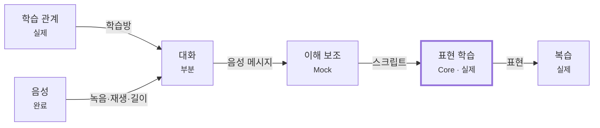

# Talklog 통합 기획서

2026-10-28 기준

## 개요

Talklog는 학습 짝과 비동기 음성 메시지를 주고받으며, 대화에서 발견한 표현을 카드로 저장해 복습하는 모바일 우선 외국어 학습 프로토타입이다. 음성 메시지 앱과 카드 복습 앱 사이의 이음새를 자연스럽게 만드는 것이 제품의 주장이다.

**대표 사용자**: 일본어 초·중급 학습자. 학습 짝과 회화 연습을 하고 싶지만 실시간 통화는 부담스럽고, 대화 중 새로 알게 된 표현을 나중에 복습하고 싶다. 모바일 앱 사용에 익숙하다.

**핵심 시나리오**: 민지는 유키가 보낸 음성을 듣고 스크립트를 연다. 모르는 부분 `過ごした` 만 골라 뜻을 "보내다, 지내다"라고 적어 저장한다. 그 표현이 나온 문장 전체가 예문으로 남고, 카드 화면에서 확인한 뒤 복습한다.

| 항목 | 내용 |
| --- | --- |
| 형태 | Next.js 웹 앱, 520px 모바일 셸 |
| 학습 언어 | 일본어 중심. 학습방 개설 시 일본어·영어·중국어 선택 (004) |
| 데이터 | 브라우저 저장소 (서버 없음) |
| 저장소 | [balbi-hw/talklog-user-prototype](https://github.com/balbi-hw/talklog-user-prototype) |

## 목적과 검증 질문

프로토타입의 목적은 기능 완성이 아니라, 사용자가 설명 없이 핵심 흐름을 따라갈 수 있는지 확인하는 것이다. 다음 다섯 질문에 답해야 한다.

1. 사용자는 서비스의 목적을 빠르게 이해할 수 있는가?
2. 사용자는 별도 설명 없이 다음 행동을 선택할 수 있는가?
3. 음성 대화에서 카드 학습으로 자연스럽게 이동할 수 있는가?
4. 사용 과정에서 불필요하거나 반복적인 단계는 없는가?
5. 사용자가 가장 중요하다고 느끼는 기능은 무엇인가?

### 클릭 프로토타입에서 실제 구현으로

초기 기획(`draft.md`)은 Figma로 만드는 클릭 가능한 프로토타입을 전제했다. 녹음·저장·복습 알고리즘을 "구현하지 않아도 된다"고 두었다. 현재는 백엔드 없이 가능한 범위까지 실제로 만든다 — 실제 녹음(001), 표현 저장(002), 복습(003), 학습방 목록·개설(004), 카드 편집(005)이 끝났다.

문서에 남아 있는 근거는 두 가지다.

- **가짜는 검증을 흐린다** (헌법 원칙 II): 무엇이 진짜인지 흐려지는 순간 프로토타입은 검증 도구로서 신뢰를 잃는다. 눌러도 아무 일이 없는 버튼은 "다음 행동을 선택할 수 있는가"를 제대로 관찰하지 못하게 한다.
- **예외 경로는 진짜에서만 드러난다** (원칙 V): 마이크 권한 거부, 저장소 차단 같은 상황은 클릭 프로토타입으로 검증할 수 없다.

서버·외부 API가 필요한 기능(STT, 번역, AI 교정, 실시간 수신, 로그인)은 여전히 Mock이며, 도입하려면 헌법 개정이 먼저다.

> 방향 전환 근거는 헌법 원칙에서 추론한 것이다. 실제 이유가 따로 있었다면 이 절을 고친다.

## 핵심 사용자 흐름

14단계 중 9단계가 실제로 동작하고, 2단계는 부분 동작, 3단계는 Mock이다. 남은 Mock과 부분 동작은 모두 서버나 외부 API가 필요한 부분이다. 모든 기능 명세(`specs/NNN-*`)는 이 중 어느 단계를 검증하는지 밝힌다.

| # | 단계 | 화면 | 상태 | 비고 |
| --- | --- | --- | --- | --- |
| 1 | 앱 실행 | 홈 | 실제 | 003·006: 기기 날짜, 실제 복습 대상 수·저장한 표현 수·누적 정답률 |
| 2 | 진행 중인 학습방 확인 | 홈 · 학습방 목록 | 실제 | 004: 홈에 최근 활동 순 3개, 전체 목록·개설·삭제. 예시 학습방 별도 |
| 3 | 학습방 입장 | 음성 대화 | 실제 | |
| 4 | 학습 짝의 음성 메시지 확인 | 음성 대화 | Mock | 예시 메시지 1개. 수신은 백엔드 필요 |
| 5 | 음성 재생 | 음성 대화 | 부분 | 내 녹음은 재생. 예시 메시지는 소리가 없어 재생 비활성 |
| 6 | 생성된 스크립트 확인 | 음성 대화 | Mock | 고정 텍스트 토글. STT 미구현 |
| 7 | AI 교정 또는 번역 확인 | AI 피드백 | Mock | 고정 텍스트. 이 화면의 저장 버튼만 실제 |
| 8 | 답장 음성 녹음 | 음성 대화 | 실제 | 001: 최대 60초, 권한 상황별 안내 |
| 9 | 답장 전송 | 음성 대화 | 부분 | 미리 듣기·전송 단계는 실제. 학습 짝에게 전달되지는 않음 |
| 10 | 스크립트에서 표현 선택 | 음성 대화 | 실제 | 002: 마우스·터치·키보드 |
| 11 | 표현을 카드로 저장 | 음성 대화 | 실제 | 002: 브라우저 저장소, 중복 차단 |
| 12 | 생성된 카드 확인 | 카드 | 실제 | 002: 목록·개수·삭제 |
| 13 | 간단한 복습 진행 | 복습 | 실제 | 003: 오늘 대상 최대 20장, 기억 여부에 따른 간격 반복 |
| 14 | 학습 결과 확인 | 학습 완료 | 실제 | 003: 카드별 최종 응답 통계 |

## 서브도메인과 용어집

Core는 대화도 복습도 아닌 **표현 학습**, 즉 둘 사이의 이음새다. 녹음이 잘 되고 복습이 훌륭해도, 대화에서 표현을 꺼내 카드로 만드는 동작이 어색하면 두 앱을 억지로 붙인 것이 된다. 프로토타입이 검증할 축은 `음성 → 이해 보조 → 표현 학습 → 복습` 사슬이다.

화살표는 상류에서 하류로 가는 것을 나타낸다. 계정은 모든 컨텍스트에 식별자를 주는 상류이고, 알림은 대화·복습의 변화를 읽기만 하는 하류다. 둘 다 아직 없다.

| 서브도메인 | 책임 | 분류 | 현재 상태 |
| --- | --- | --- | --- |
| 표현 학습 | 대화에서 발견한 표현을 학습 자산으로 만든다 | Core | 실제 — 002 선택·저장·카드 목록, 005 표현·뜻 편집. 문장 다듬기(AI)는 Mock |
| 복습 | 저장한 표현을 기억으로 만든다 | Core 지원 | 실제 — 003 오늘 대상·간격 반복·학습 완료 |
| 음성 | 녹음·재생·길이를 다룬다 | Supporting | 완료 — 001 |
| 대화 | 학습 짝과 비동기로 음성 메시지를 주고받는다 | Supporting | 부분 — 내가 녹음한 메시지만 실제 |
| 이해 보조 | 들은 음성을 읽고 뜻을 알 수 있게 한다 | Supporting | Mock — 고정 텍스트 토글 |
| 학습 관계 | 누구와 어떤 언어를 공부할지 정한다 | Supporting | 실제 — 004 목록·개설·삭제. 초대는 미구현 |
| 계정 | 사용자를 식별한다 | Generic | 없음 |
| 알림 | 돌아올 이유를 만든다 | Generic | 없음 |

### 용어집

같은 개념은 문서·코드·화면에서 한 단어로만 부른다. "쓰지 않는 말"은 헌법 원칙 I이 문서·코드 식별자·화면 문구에서 금지한다.

| 용어 | 코드 식별자 | 정의 | 쓰지 않는 말 |
| --- | --- | --- | --- |
| 학습방 | `room` | 한 명의 학습 짝과 하나의 학습 언어로 묶인 대화 공간 | 채팅방, 방, 대화방 |
| 학습 짝 | `partner` | 학습방을 함께 쓰는 사람 | 친구, 상대방, 유저 |
| 음성 메시지 | `VoiceMessage` | 학습방에 놓인, 보낸 사람이 정해진 음성 | 오디오, 보이스, 음성 파일 |
| 녹음 | `VoiceRecording` | 아직 보내지 않은, 전송 전 확인 단계의 음성 | 임시 파일, 드래프트 |
| 스크립트 | `transcript` | 음성을 학습 언어 문자로 옮긴 것 | STT 결과, 원문, 자막 |
| 번역 | `translation` | 스크립트를 모국어로 옮긴 것 | 해석, 뜻풀이 |
| 표현 | `Expression` | 학습자가 배우기로 정한 언어 단위. 단어·구·문장을 모두 포함 (결정 D-1) | 단어, 어휘, 문장, 구문 |
| 다듬은 문장 | `refinedSentence` | 학습자가 말한 문장을 더 자연스럽게 바꾼 것 | 교정, 첨삭, 수정문 |
| 카드 | `Card` | 복습 단위. 표현 하나당 카드 하나 | 플래시카드, 단어카드 |
| 복습 | `review` | 카드를 꺼내 기억 여부를 확인하는 행위 | 학습, 테스트, 퀴즈 |

## 화면 구성

기획한 9개 화면이 모두 다뤄졌다. 7개는 독립 화면이고, 녹음과 표현 선택은 별도 화면 대신 음성 대화 화면 안에 들어갔다. 화면마다 주요 행동은 하나다.

| 화면 | 주요 행동 | 검증할 것 | 현재 |
| --- | --- | --- | --- |
| 홈 | 진행 중인 학습방 또는 오늘의 복습으로 들어간다 | 지금 해야 할 행동이 바로 보이는가, 대화와 카드의 관계가 보이는가 | 있음. 실제 값 (003·004·006) |
| 학습방 목록 | 학습방을 고르거나 새로 만든다 | 학습 짝과 학습 언어를 구분할 수 있는가, 새 메시지가 있는 방을 찾기 쉬운가 | 있음 (004). 새 메시지 표시는 수신이 없어 미구현 |
| 음성 대화 | 음성 메시지를 듣고 답장한다 | 시간 순서와 보낸 사람이 구분되는가, 재생·스크립트·번역이 복잡해 보이지 않는가 | 있음. 가장 중요한 화면 |
| 음성 녹음 | 녹음하고 미리 들은 뒤 전송한다 | 녹음 중 상태가 보이는가, 실수로 바로 전송되지 않는가 | 음성 대화 화면 안 녹음기 (001) |
| 스크립트·AI 피드백 | 다듬은 문장을 확인하고 표현을 저장한다 | 스크립트·번역·다듬은 문장이 혼동되지 않는가, 이유를 이해하는가 | 있음. 내용은 Mock, 저장은 실제 |
| 표현 선택·카드 생성 | 고른 표현에 뜻을 적어 저장한다 | 무엇을 저장하는지 분명한가, 과정이 길지 않은가 | 스크립트 아래 저장 수단 (002) |
| 카드 목록 | 저장한 표현을 확인하고 지운다 | 대화에서 만든 카드임을 아는가, 복습할 카드와 전체를 구분하는가 | 있음 (002, 화면 제목 "내 표현"). 편집 (005) |
| 복습 | 카드를 뒤집고 기억 여부를 고른다 | 앞뒷면 정보가 적절한가, 한 번의 복습이 너무 많은 행동을 요구하지 않는가 | 있음 (003) |
| 학습 완료 | 다음 행동으로 돌아간다 | 성취감을 느끼는가, 통계가 부담스럽지 않은가 | 있음 (003) |

표현 선택을 별도 화면이 아니라 스크립트 바로 아래에 둔 것은 "저장 과정은 최대한 짧게" 원칙 때문이다. 스크립트를 연 뒤 4번 이하의 조작(고르기 → 저장 시작 → 뜻 적기 → 저장)으로 끝난다.

## 설계 원칙과 상태 설계

흐름을 방해하지 않는 것이 모든 원칙의 공통점이다. 대화가 주인이고, 학습과 AI는 필요할 때만 열린다.

- **한 화면, 한 주요 행동**: 음성 대화는 확인 또는 답장, 카드 생성은 저장, 복습은 기억 여부 선택.
- **대화와 학습은 분리하되 연결한다**: 대화 중에는 표현 저장만 제공하고, 복습은 사용자가 원할 때 한다.
- **AI는 기본 행동을 막지 않는다**: 재생 → 필요할 때 스크립트나 AI 피드백 열기 → 바로 답장. AI 분석 대기나 교정 확인을 필수 단계로 두지 않는다.
- **저장은 짧게**: 2~3단계 안에서 끝낸다. 현재는 자동 번역이 없어 뜻을 사용자가 직접 적으므로 4단계다.
- **언제든 원래 흐름으로**: 저장 후 대화로, AI 피드백에서 메시지로, 복습 중 대화 출처를 본 뒤 복습으로 돌아온다.
- **접근성은 처음부터**: 모든 컨트롤은 키보드로 다룰 수 있고, 아이콘만 있는 버튼은 라벨을 갖는다 (헌법 원칙 III).

### 상태 설계

성공 경로만으로는 완료가 아니다 (헌법 원칙 V). 목록은 빈 상태를, 권한에 기대는 기능은 거부 상태를, 되돌릴 수 없는 동작은 확인 단계를 갖는다.

| 종류 | 상황 | 현재 처리 |
| --- | --- | --- |
| 빈 상태 | 저장한 표현이 없음 | 저장 방법 안내 (002) |
| 빈 상태 | 오늘 복습할 카드가 없음 | 이유와 가장 빠른 예정일 또는 저장 방법 안내 (003) |
| 빈 상태 | 직접 만든 학습방이 없음 | 개설 또는 예시 학습방 안내 (004) |
| 처리 중 | 저장소를 아직 읽지 않음 | 빈 상태와 구분해 안내를 숨김 (002) |
| 처리 중 | 업로드·STT·AI 교정 | 백엔드가 없어 해당 없음 |
| 실패 | 저장소를 쓸 수 없음 | 실패를 알리고 다시 읽기·다시 시도 가능 (002~005). 편집 실패 시 입력 유지 (005) |
| 실패 | 마이크 장치 없음·브라우저 미지원 | 상황별 안내 (001) |
| 권한 | 마이크 권한 거부 | 상황별 안내 (001) |
| 확인 단계 | 녹음 전송, 표현 삭제, 학습방 삭제 | 미리 듣기 후 전송 (001), "지울까요?" 확인 (002), 되돌릴 수 없음 안내 후 삭제 (004) |

## 현재 구현 현황

로드맵 2단계까지 끝났다. 001(녹음·재생), 002(표현 선택·저장), 003(복습), 004(학습방 목록·개설), 005(카드 편집), 006(공통 셸 원칙 정리)이 master에 들어갔다. 실기기 확인(002 롱프레스 선택, 실제 마이크, 스크린리더)은 이번 범위에서 생략했다.

| 날짜 | 항목 | 내용 |
| --- | --- | --- |
| 2026-10-28 | 2단계 병합 (PR #1·#2) | 002와 003~006을 master에 병합 |
| 2026-10-27 | 006 공통 셸 원칙 정리 | 동작하지 않는 프로필·마이 버튼 제거, 홈 날짜 실제화, 용어집 위반·색상 리터럴 정리, 통합 검증 결함 2건 수정 |
| 2026-10-27 | 003·004·005 구현 | 복습·학습 완료, 학습방 목록·개설·삭제, 카드 편집. 기능별 병렬 구현 후 통합 검증 통과 |
| 2026-10-27 | 002 보완 (T030–T036) | 검증에서 드러난 키보드 선택 불가·포커스 유실·저장소 복구 불가 수정, 용어 정리. 자동화 검증 55개 통과 |
| 2026-09-10 | 002 구현 (T001–T028) | 표현 선택·저장·카드 목록·삭제, 카드 화면과 Feedback의 가짜 동작 제거 |
| 2026-09-09 | 002 명세·계획·작업 | 스크립트에서 표현 선택·저장 |
| 2026-09-09 | 도메인 모델, 헌법 v1.1.0 | 서브도메인 지도·용어집 제정, 용어집 준수를 MUST로 |
| 2026-09-09 | 001 실제 음성 녹음·재생 | 최대 60초 녹음, 미리 듣기·다시 녹음·취소, 권한·장치·미지원 안내 |
| 2026-09-09 | spec-kit 도입 | 명세 주도 개발 시작, 헌법 v1.0.0 |
| 2026-07-22 | 초기 프로토타입 | 클릭 가능한 화면 흐름, 전부 Mock |

### 남아 있는 Mock

모두 예시임이 화면에서 식별되며(원칙 II), 서버나 외부 API가 있어야 실제로 바꿀 수 있다.

- 예시 학습방 "유키와 일본어 대화": 삭제할 수 없고, 학습 짝의 예시 메시지 1개와 그 스크립트·번역을 담는다
- AI 피드백: 다듬은 문장과 이유 설명 (저장만 실제)
- 학습 짝 초대: 미구현임을 화면에 표시
- 녹음한 음성 메시지: 학습방별 브라우저 메모리에만 보관해 새로고침하면 사라진다

## 로드맵

백엔드 없이 할 수 있는 기능을 먼저 끝내고, 그다음 헌법을 개정해 서버로 넘어간다. 2단계까지 끝났으므로 다음은 **헌법 개정 게이트**다.

```mermaid
flowchart LR
    subgraph P1["1단계 · 완료"]
        direction TB
        a1["001 음성 녹음·재생"]
        a2["002 표현 선택·저장"]
        a3["카드 목록·삭제"]
    end
    subgraph P2["2단계 · 완료"]
        direction TB
        b1["003 복습 스케줄"]
        b2["학습 완료 화면"]
        b3["홈의 숫자를 실제 값으로"]
        b4["004 학습방 목록·개설"]
        b5["005 카드 편집"]
        b6["006 공통 셸 원칙 정리"]
    end
    gate{"<b>다음: 헌법 개정</b><br/><small>서버·외부 API 허용</small>"}
    subgraph P3["3단계 · 헌법 개정 후"]
        direction TB
        c1["학습 짝 메시지 수신"]
        c2["실제 STT·번역"]
        c3["문장 다듬기 (AI)"]
        c4["로그인·알림"]
    end
    P1 --> P2 --> gate --> P3
```

2단계가 끝나 14단계 흐름에서 백엔드가 필요 없는 부분은 모두 실제로 동작한다. Core 사슬(대화 → 표현 → 카드 → 복습)이 처음으로 끝까지 이어졌다.

3단계로 넘어가기 전에 정해야 할 것:

- 서버 구성: Next.js 서버 기능(Route Handler)으로 충분한가, 별도 백엔드가 필요한가
- 외부 서비스: STT·번역·문장 다듬기에 쓸 API와 비용 한도
- 저장 위치: 브라우저 저장소의 표현·복습·학습방 데이터를 서버로 옮길 때의 이전 방식
- 헌법 개정 범위: 원칙 IV(최소 의존성)와 기술 제약 "서버·데이터베이스·외부 API를 추가하지 않는다"를 어떻게 바꿀지

사용자 테스트(아래 절)는 2단계 상태로도 진행할 수 있다. Mock이 남은 단계(4·6·7)는 예시 학습방으로 관찰한다.

## 개발 방식과 제약

기능은 spec-kit 기반 명세 주도 개발(SDD)로 만든다. 기능 하나가 `specs/NNN-*` 폴더 하나이며, 명세·계획·작업·검증 시나리오를 담는다.

1. `/speckit-specify` — 기술 선택 없이 요구사항과 수용 기준만
2. `/speckit-clarify` — 모호한 영역 해소 (선택)
3. `/speckit-plan` — 기술 계획, 계약, 데이터 모델, 헌법 점검
4. `/speckit-tasks` — 사용자 스토리 단위 작업 분해
5. `/speckit-analyze` — 산출물 간 일관성 검토 (선택)
6. `/speckit-implement` — 구현

### 헌법 원칙 (v1.1.0)

| 원칙 | 핵심 규칙 |
| --- | --- |
| I. 도메인 경계와 흐름 검증 | 명세는 서브도메인·분류·검증하는 흐름 단계를 밝힌다. 용어집을 따른다 |
| II. Mock 경계 명시 | 동작하지 않는 버튼이 동작하는 것처럼 보여서는 안 된다 |
| III. 모바일 우선·접근성 | 520px 셸 기준, 모든 컨트롤은 키보드로 조작 가능 |
| IV. 최소 의존성 | 표준 브라우저 API 우선, 새 의존성은 대안 검토와 함께 기록 |
| V. 상태 전이 완결성 | 대기·진행·성공·실패·권한 거부·빈 상태·확인 단계를 정의 |

### 기술 제약

- Next.js 15 App Router, React 19, TypeScript 5 `strict`, Tailwind CSS 4
- 런타임 의존성은 next·react·react-dom 3개
- 서버·데이터베이스·외부 API를 추가하지 않는다. 영속성은 브라우저 저장소
- 색상은 `globals.css`의 CSS 변수로만 정의
- 개발 환경은 Windows, spec-kit 스크립트는 PowerShell 변형

### 품질 게이트

- `npm run build` 성공, TypeScript 오류 0
- quickstart의 수동 시나리오를 전부 통과 — 하나라도 실패하면 완료로 보고하지 않는다
- 자동화 테스트는 현재 필수가 아니다. 002~006 검증은 Playwright로 자동 실행했지만 프로젝트에 포함하지 않았다

## 사용자 테스트와 완료 기준

프로토타입은 외부 사용자 3~5명이 설명 없이 14단계를 끝까지 통과하고, 막힌 지점을 기록할 수 있을 때 완료다. 기능을 설명하지 않고 직접 쓰게 한 뒤 행동을 관찰한다.

### 측정 기준

| 기준 | 목표 |
| --- | --- |
| 설명 없이 학습방에 입장 | 도움 없이 완료 |
| 음성 재생 버튼 찾기 | 10초 안 |
| 음성 답장 완료 | 도움 없이 완료 |
| 표현을 카드로 저장 | 도움 없이 완료, 스크립트를 연 뒤 4번 이하의 조작 |
| 저장한 카드의 위치 찾기 | 도움 없이 완료 |
| 전체 핵심 흐름 | 중단 없이 완료, 불필요한 클릭 수 기록 |
| 같은 문제를 겪은 사용자 수 | 5명 중 몇 명인지 기록 |

### 관찰 항목

- 첫 화면에서 무엇을 먼저 누르는가, 음성 메시지를 알아차리는가
- 스크립트와 번역의 차이를 이해하는가, AI 피드백을 반드시 봐야 한다고 느끼는가
- 스크립트에서 표현을 고르는 방법을 설명 없이 찾아내는가 (002 SC-008)
- 무엇을 저장하는지 혼동하지 않는가 — 단어만, 또는 문장만 저장해야 한다고 오해하지 않는가 (002 SC-007)
- 저장한 표현이 어디로 갔는지 이해하고 복습으로 자연스럽게 이동하는가
- 이전 화면으로 돌아가다 막히거나 망설이는 지점은 어디인가

### 인터뷰 질문

- **테스트 전**: 평소 회화 연습 방법, 실시간 통화 학습에 대한 부담, 모르는 표현을 기록하는 방식, 카드 학습 앱 사용 경험
- **테스트 중** (멈췄을 때만): 지금 무엇을 하려고 하나요? 다음에 어떤 화면이 나올 것 같나요?
- **테스트 후**: 가장 쉬웠던 부분과 헷갈린 부분, 불필요한 기능, 음성 대화와 카드가 자연스럽게 이어진다고 느꼈는지, 다시 쓰고 싶은지

## 열린 질문과 문서 관계

### 열린 질문

- [x] 복습 스케줄 규칙 — 003에서 결정: "알고 있어요"는 1일에서 시작해 두 배씩(최대 30일), "다시 볼래요"는 오늘 다시이며 세션 끝에 한 번 재등장
- [ ] 용어집의 "단어·문장"을 언어 범주를 설명할 때 쓰는 것을 허용할까? (헌법·용어집 PATCH 개정 안건)
- [ ] 소리를 듣기 힘든 상황을 위해 음성 메시지 전체를 스크립트로 보는 탭을 둘까? (`draft.md`에 남은 메모)
- [x] 개인 대화와 그룹 대화 — 004에서 결정: 개인 대화만 다룬다
- [ ] 카드에 덱·태그·발음이 필요한가? 초기 기획에는 있었지만 002 범위에서 빠졌다
- [ ] 사용자 테스트 참가자 모집과 일정은 누가 언제 맡는가
- [ ] 3단계 서버 구성과 외부 서비스 선택 (헌법 개정 전에 결정)

### 문서 관계

이 기획서는 흩어져 있던 문서를 한곳에 모은 요약본이다. 충돌하면 아래 우선순위를 따른다.

| 우선순위 | 문서 | 역할 |
| --- | --- | --- |
| 1 | `.specify/memory/constitution.md` | 개발 원칙과 품질 게이트 |
| 2 | `docs/domain-model.md` | 서브도메인 지도, 용어집, 다음 작업 후보 |
| 3 | `README.md` · `draft.md` | 설치·실행 안내, 초기 기획 초안 (클릭 프로토타입 전제, 예전 용어) |
| — | `specs/NNN-*/` | 기능별 명세·계획·작업·검증 |
